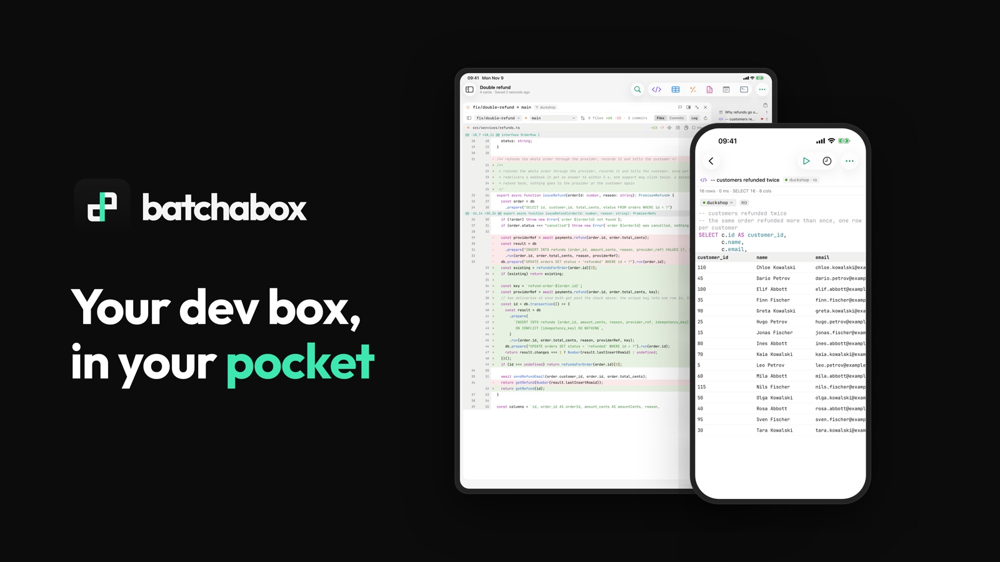
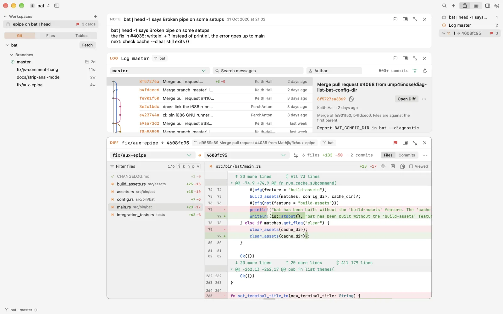
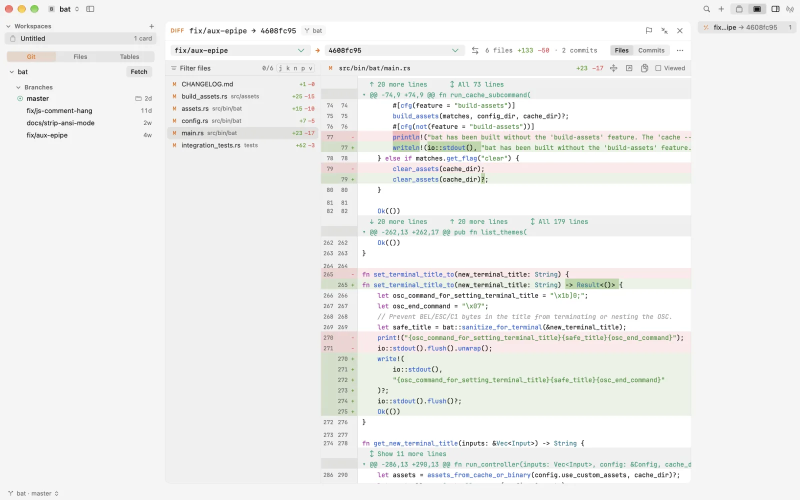
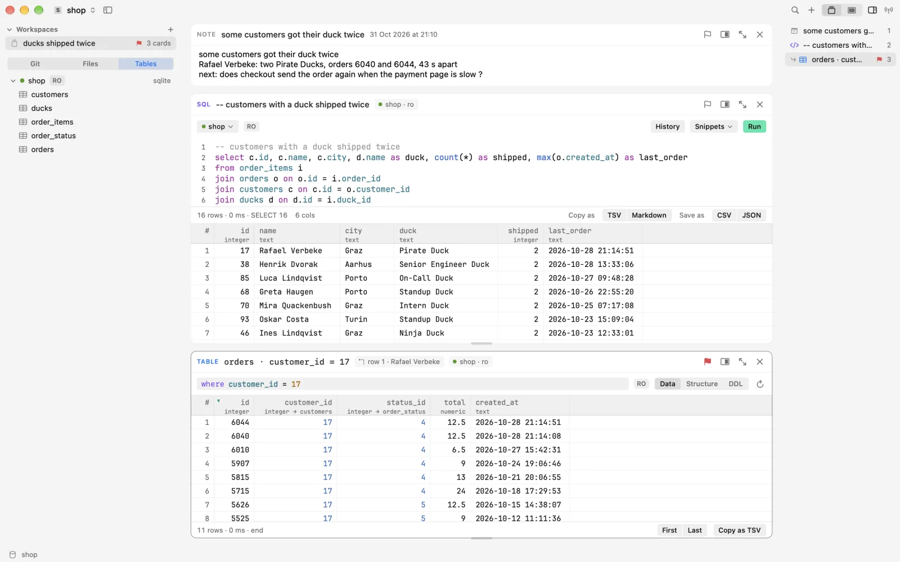
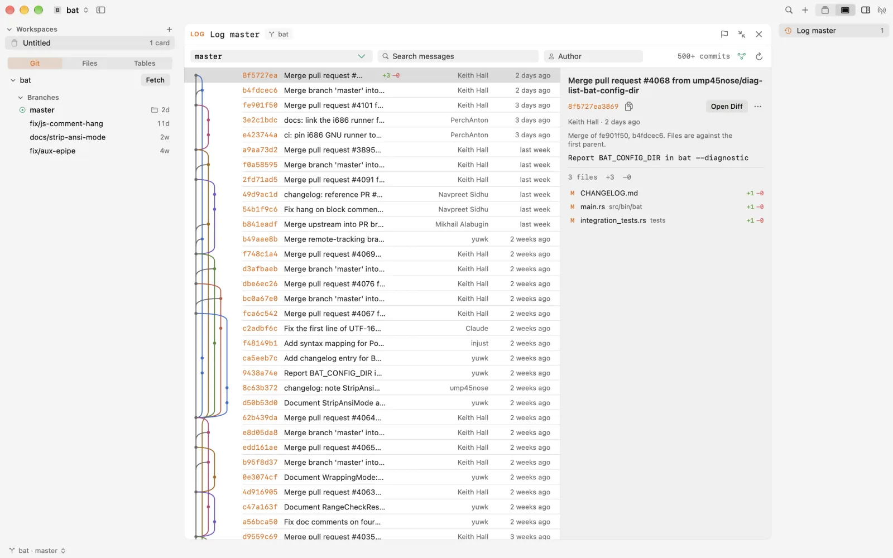
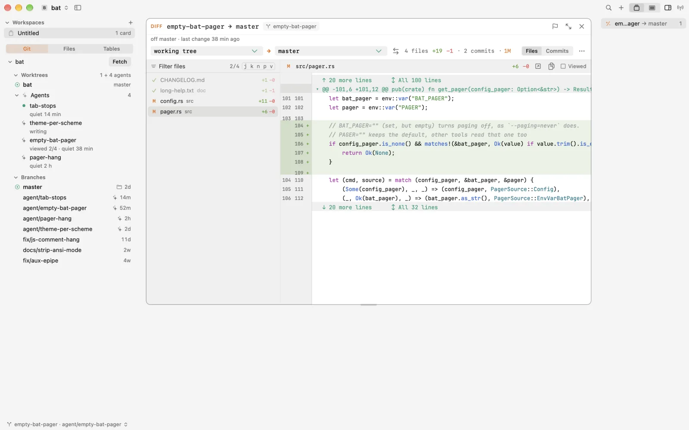
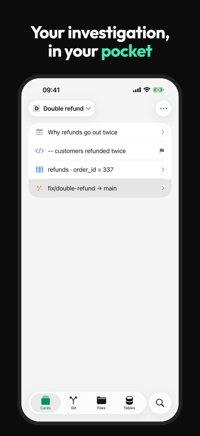
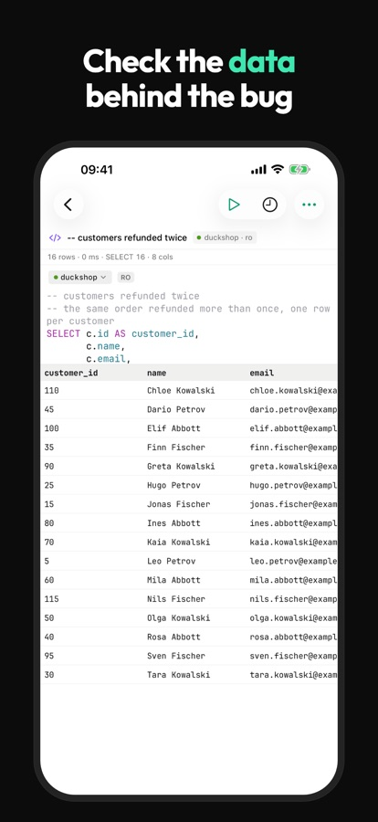
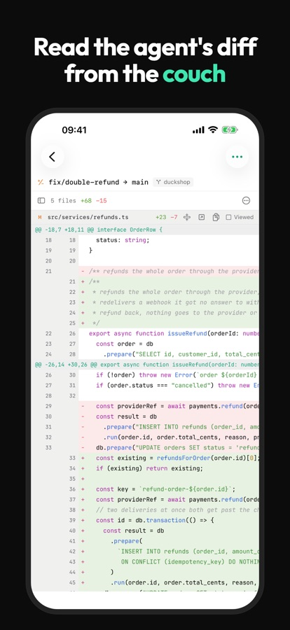
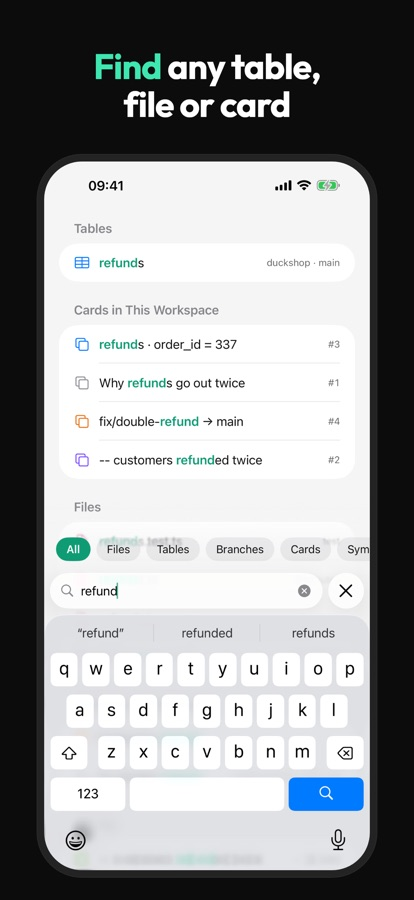

## The agent writes it. You read it here.

**[Batchabox](https://batchabox.app)** is a native Mac app for checking your agent's work. Git, files, databases and a shell in one window, every card linked to where it came from. Pair your iPhone or iPad once and the same box goes with you.

**[Download for Mac](https://updates.batchabox.app/Batchabox-latest.dmg)** · **[iPhone and iPad on the App Store](https://apps.apple.com/app/batchabox/id6832096188)** · [Docs](https://batchabox.app/docs) · [Release notes](https://batchabox.app/releases)

Free for personal use. Always. Work is free while in beta.

<picture>
  <source media="(prefers-color-scheme: dark)" srcset="assets/hero-dark-1600.webp">
  
</picture>

## The daily parts of an IDE, minus the heavy bits

What you open ten times a day while checking your agent's work. Nothing you haven't touched since last year.

- **Every agent's worktree, as a review queue.** Conductor, worktrunk, gtr, a `.worktrees` folder or your own pattern. A row per agent with what needs you now: still writing, quiet for 38 minutes, 2 of 4 files viewed, done.
- **The whole review, in one card.** Any branch against its base, word by word. Stage a hunk, commit, push, pull, cherry-pick, stash, and the conflicts a pull stops on.
- **The history, drawn.** Branches and merges as lanes, a commit's message and files beside it, its diff one click away.
- **Read the code the agent touched.** Syntax colours, go to definition and find in files, with quick fixes in place.
- **Your connections, with a prod pill.** PostgreSQL, MySQL, MariaDB and SQLite, found in your `.env` files. Follow foreign keys, edit cells right in the grid, and every save goes in as one transaction. Each connection is read-only, preview first, or direct.
- **A quick command, in the right place.** In the project or inside its Docker Compose service. The output is a card.
- **⌘K finds all of it.** Branches, open cards, files, tables, commands.

<table>
  <tr>
    <td width="50%"><picture><source media="(prefers-color-scheme: dark)" srcset="assets/diff-dark-1600.webp"></picture></td>
    <td width="50%"><picture><source media="(prefers-color-scheme: dark)" srcset="assets/db-dark-1600.webp"></picture></td>
  </tr>
  <tr>
    <td><picture><source media="(prefers-color-scheme: dark)" srcset="assets/log-dark-1600.webp"></picture></td>
    <td><picture><source media="(prefers-color-scheme: dark)" srcset="assets/worktrees-dark-1600.webp"></picture></td>
  </tr>
</table>

## Leave the desk, keep the diff

Pair your iPhone or iPad once and pick up where you left off, with the same projects, cards and even unsaved edits. It talks straight to your Mac, at home or over your VPN. Each device gets its own key, and you can revoke it any time.

  
  
  
  

## Native, and measured

Written in Swift and AppKit, not another gigabyte of Electron.

| | |
|---|---|
| **0.35 s** | from opening the app to a window that takes input |
| **119 fps** | scrolling a stack of mixed cards on a 120 Hz display |
| **~19 ms** | to search 434,559 symbols with ⌘K |
| **~290 MB** | for the whole app at rest, with the repo open |

Measured on a MacBook Pro M4 Max, on the VS Code repo. [How we measure](https://batchabox.app/docs/performance).

## No telemetry. No account. Nothing phones home.

Your code, your databases and your credentials stay on your machines. We never see them, and the app sends us nothing about how you use it. [Privacy](https://batchabox.app/privacy).

## What's coming next

The same app on your Linux desktop and on Windows, the remote client for Android, and a real terminal next to your diffs.

---

**Found a bug or want something?** [Open an issue](https://github.com/batchabox/batchabox/issues/new/choose). **Anything else:** box@batchabox.app

Batchabox is closed source, made by [Chillbor s.r.o.](https://chillbor.dev) in Bratislava. This organisation holds the public issue tracker, not the code.
