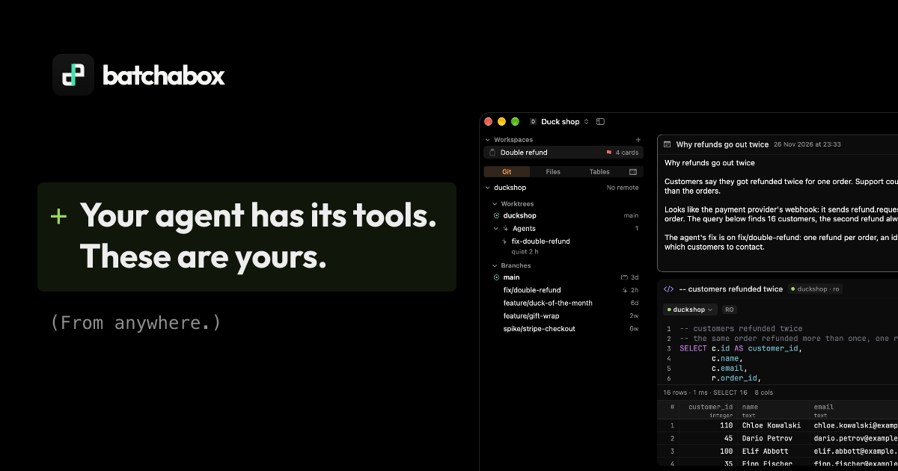
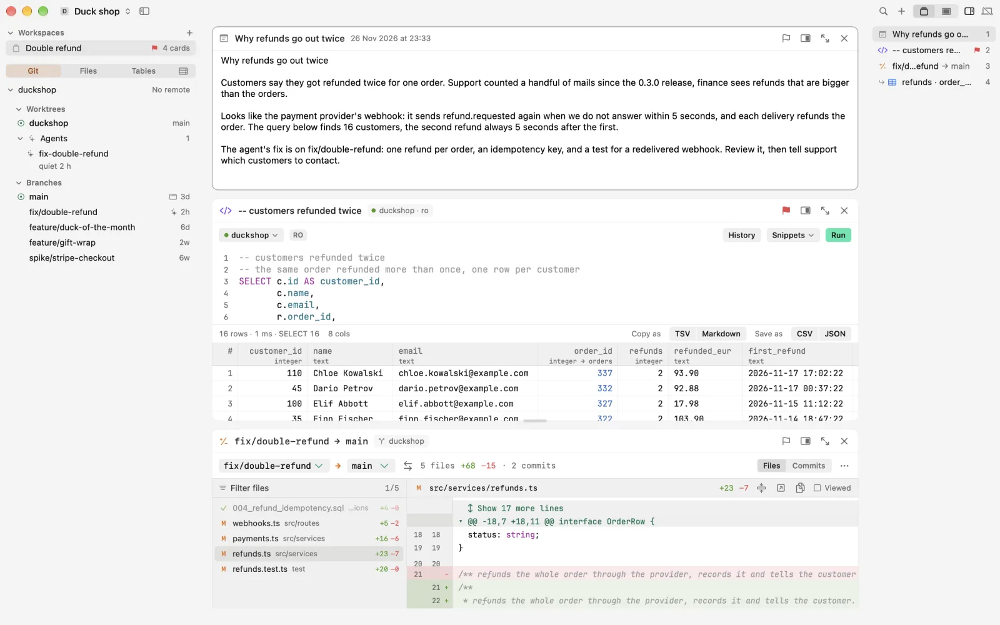
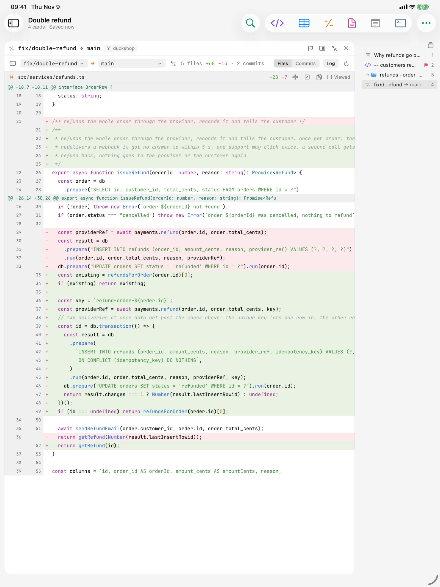
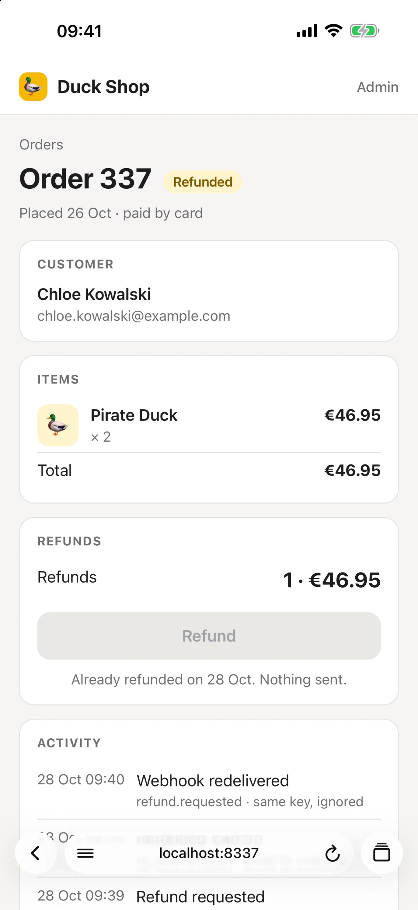

## Your agent has its tools. These are yours. (From anywhere.)

**[Batchabox](https://batchabox.app)** is a native Mac app for checking what your agent wrote: Git, files and databases in one window, every card linked to where it came from. On the Mac, the iPhone and the iPad.

**[Download for Mac](https://updates.batchabox.app/Batchabox-latest.dmg)** · **[iPhone and iPad on the App Store](https://apps.apple.com/app/batchabox/id6832096188)** · [Linux, early access](https://batchabox.app/linux) · [Docs](https://batchabox.app/docs)

## One bug, three screens

<table>
  <tr>
    <td width="58%"><picture><source media="(prefers-color-scheme: dark)" srcset="assets/investigation-dark-1600.webp"></picture></td>
    <td width="26%"><picture><source media="(prefers-color-scheme: dark)" srcset="assets/ios-ipad-diff-dark.webp"></picture></td>
    <td width="16%"><picture><source media="(prefers-color-scheme: dark)" srcset="assets/ios-iphone-browser-dark.webp"></picture></td>
  </tr>
  <tr>
    <td><b>Mac · Tue 14:06</b> Find the sixteen customers. Hand it to the agent.</td>
    <td><b>iPad · 19:40</b> Read what it wrote, from the couch.</td>
    <td><b>iPhone · Wed 08:15</b> Test it.</td>
  </tr>
</table>

## Why bother

| | |
|---|---|
| **0.35 s** | from opening the app to a window that takes input |
| **119 fps** | scrolling on a 120 Hz display. We are still actively looking for the missing frame. |
| **~150 MB** | for the whole app at rest, with the repo open |
| **None** | telemetry. No account either. |

More in the [docs](https://batchabox.app/docs): [why it is not another IDE](https://batchabox.app/docs/scope), [the iPhone and iPad](https://batchabox.app/docs/iphone-and-ipad), [your localhost on them](https://batchabox.app/docs/browser), and [how we measure](https://batchabox.app/docs/performance) instead of making numbers up.

Free for personal use. For work, free in the beta, then €79 a year, on your honour. [Pricing](https://batchabox.app/docs/pricing).

---

**Feedback:** [GitHub issues](https://github.com/batchabox/batchabox/issues/new/choose) · box@batchabox.app

Batchabox is closed source, made by [Chillbor s.r.o.](https://chillbor.dev) in Bratislava. This organisation holds the public issue tracker, not the code.
